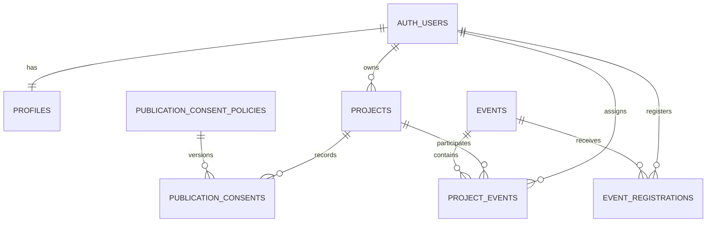

# OFE database foundation

This document describes the compatible Supabase database layer owned by Developer 2. The React frontend continues to read and write `projects(id, owner_id, data)` and `events(id, data)`; normalized tables add profiles, publication-consent history, and authoritative event assignments behind that interface.

## Migration order

Apply these files once, in timestamp order:

1. `supabase/migrations/20261022_accounts.sql`
2. `supabase/migrations/20261023071333_database_foundation.sql`
3. `supabase/migrations/20261023074400_event_registration_user_index.sql`
4. `supabase/migrations/20261023115503_storage_security_hardening.sql`

Use the Supabase SQL Editor or the team's established migration deployment workflow. Do not paste a service-role key into the frontend or any committed file.

## Data relationships



`project_events` is authoritative. The legacy `projects.data.eventYears` array remains temporarily for frontend compatibility, but it must not be used to grant participation or authorization.

For legacy data, the migration creates a link only when a four-digit year matches exactly one event's `data.date`. Unmatched and ambiguous years are deliberately skipped. Their historical `assigned_by` value is `NULL` because no administrator identity can be proven.

## Role matrix

| Data | Guest | Project owner | Other student | Administrator |
| --- | --- | --- | --- | --- |
| Profile | No access | Read/update own display name | No access | Read all |
| Private project | No access | Read/update allowed content | No access | Read/moderate |
| Public project | Read when approved, visible, and currently consented | Read | Read | Read/moderate |
| Consent history | No access | Read own project history | No access | Read all |
| Consent changes | No direct table writes | Via compatible project fields only | No access | Cannot impersonate owner |
| Project-event links | Public links only | Read own links | Public links only | Create/read/delete |
| Events | Published only | Published only | Published only | Create/update/read |
| Startup media | Public-project media only | Read own; manage while non-public | Public-project media only | Read for moderation |

Browser roles cannot write `app_admins`, `publication_consent_policies`, or `publication_consents` directly. Administrator assignment remains a project-owner or trusted server operation.

## Consent behavior

The current policy is version `2026-10-22`, document `startup-publication-consent`. A project write appends an audit row only when `publication`, `consentVersion`, or `consentAt` changes. The owner must supply the current version and a valid timestamp no more than five minutes in the future.

Anonymous catalogue access to the compatibility `projects` table requires all of the following:

- `status = 'Approved'`
- `visible = true`
- the newest consent row for the current policy is granted

Changing unrelated project content does not duplicate the consent history. A withdrawal appends a new row and immediately removes anonymous visibility.

## Startup media contract

The `startup-media` bucket is private. It accepts PNG, JPEG, and WebP objects up to 5 MB, and every object name must use exactly one of these forms:

```text
<owner_uuid>/<project_id>/logo.webp
<owner_uuid>/<project_id>/cover.webp
```

The frontend handoff is:

1. Insert the project first so ownership can be checked by RLS.
2. Upload the image to the authenticated user's UUID prefix and that project's ID.
3. Store the object path—not a data URL or public URL—in `projects.data.image` or `projects.data.cover`.
4. Use an authenticated download or a signed URL for display. Never build a public bucket URL; the bucket must remain private.

Owners may upload, replace, or delete their own media while the project is not publicly eligible. Once the project is Approved, visible, and covered by current granted consent, its media is immutable to the owner. Administrators can read media for moderation but do not receive a browser-side write bypass. Anonymous and other authenticated users can read only media attached to projects that satisfy all public-eligibility checks. Withdrawing consent or hiding/rejecting the project immediately removes public media access.

The current frontend still creates data URLs in `src/media.tsx`. Developer 1 or Developer 3 must replace that browser-only step with the upload sequence above when wiring the UI to Supabase; this database change intentionally does not alter the finished frontend.

## Legacy event-year diagnostics

Run this read-only query after migration. A result with `match_count = 0` is unmatched; a count above one is ambiguous and must be resolved by an administrator using real event IDs.

```sql
with expanded_years as (
  select
    project.id as project_id,
    years.event_year
  from public.projects project
  cross join lateral jsonb_array_elements_text(
    case
      when jsonb_typeof(project.data->'eventYears') = 'array' then project.data->'eventYears'
      else '[]'::jsonb
    end
  ) as years(event_year)
  where years.event_year ~ '^[0-9]{4}$'
), matches as (
  select
    expanded.project_id,
    expanded.event_year,
    count(event.id) as match_count,
    coalesce(array_agg(event.id order by event.id) filter (where event.id is not null), '{}') as event_ids
  from expanded_years expanded
  left join public.events event
    on jsonb_typeof(event.data->'date') = 'string'
    and left(event.data->>'date', 4) = expanded.event_year
  group by expanded.project_id, expanded.event_year
)
select project_id, event_year, match_count, event_ids
from matches
where match_count <> 1
order by project_id, event_year;
```

## Verification

From `frontend/` run:

```bash
pnpm test:security
pnpm build
```

The local suite uses PGlite to test real PostgreSQL constraints, triggers, grants, and RLS behavior. Before launch, also run this hosted Supabase smoke checklist:

- Create users with and without `display_name`; confirm their profiles are created and isolated.
- Submit a project as an owner; confirm another student cannot read or edit it.
- Grant consent, approve, and enable visibility; confirm a signed-out request can read it.
- Withdraw consent; confirm the signed-out request can no longer read it and the history has both decisions.
- Attempt direct writes to consent/policy tables with a user token; confirm they are denied.
- Link the project to two events as an admin; confirm an owner cannot create or remove links.
- Run Supabase Database Security and Performance Advisors and resolve relevant findings before production.

## Rollback guidance

Do not drop `publication_consents` or rewrite its rows: it is an audit history. If the migration causes an integration issue, first stop the affected frontend write path, take a database backup, and ship a reviewed forward migration that relaxes or corrects the specific trigger/policy. Keep the tables and their data until the team has exported and approved a retention-safe removal plan.
